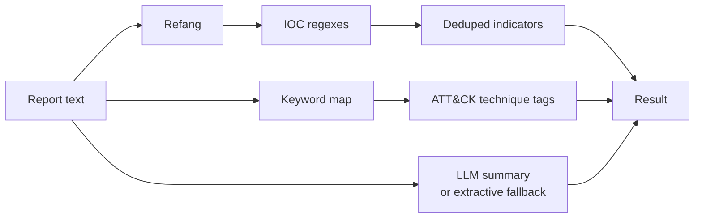

# Architecture

threatscribe converts a prose threat report into structured intelligence. This
document describes the pieces, the data flow, and why the work is split the way it
is.

## The pieces

| Layer         | Module                    | Responsibility                                   |
| ------------- | ------------------------- | ------------------------------------------------ |
| IOCs          | `threatscribe/ioc.py`     | Refang + regex extraction + dedup                |
| ATT&CK        | `threatscribe/attack.py`  | Keyword → technique tagging with evidence        |
| CVSS          | `threatscribe/cvss.py`    | CVSS v3.1 parse + base score + severity + impact tagging |
| Summary       | `threatscribe/summarize.py`| LLM summary + deterministic extractive fallback |
| LLM           | `threatscribe/llm/`       | Provider-agnostic client with a fallback cascade |
| Orchestration | `threatscribe/service.py` | Combine the three into one result                |
| HTTP API      | `threatscribe/main.py`    | `/analyze` over REST                             |
| CLI           | `threatscribe/cli.py`     | Demo and analyse-file                            |
| Validation    | `threatscribe/real_data.py`, `threatscribe/real_benchmark.py` | Real-CVE loader/fetcher and the real-data report |

## Data flow

## The core design decision: deterministic where it counts

The report is written for humans, but a SOC consumes the machine parts. Those
parts have a hard requirement: **exactness and reproducibility**. An indicator
feed that occasionally drops a real IOC or hallucinates a fake one creates blind
spots or wastes hunts. So:

- **IOC extraction and ATT&CK tagging are rule-based** — regexes and a curated
  keyword map. The same report always produces the same indicators and tags, each
  traceable to the text that produced it.
- **The LLM is confined to the summary** — the one output where fluency genuinely
  helps and an error is low-stakes (a human reads it) — and it is never required:
  an extractive summariser produces one offline.

This is the same principle as the portfolio's other security tools: the part with
operational consequences stays deterministic and auditable.

## IOC extraction details

Two subtleties make the extraction correct rather than naive:

1. **Refang first.** Defanged indicators (`hxxp`, `[.]`, `[at]`) are rewritten to
   their real form before matching, so a defanged URL or IP is still extracted.
2. **Order and length awareness.** Hashes are matched longest-first (SHA256 →
   SHA1 → MD5) and already-captured hashes are skipped, so a 64-hex SHA256 is not
   reported as two MD5s; domains are matched last and skipped when already inside
   a captured URL or email. Deduplication is case-insensitive.

## ATT&CK tagging: a lookup, not a classifier

Tagging maps phrases to techniques via a curated dictionary, and every tag records
the phrase that triggered it. This is deliberate: a keyword lookup is transparent
(an analyst sees exactly why a technique was tagged), auditable, and trivially
extended with new phrases. A learned classifier would be opaque and would need
labelled training data that does not exist in a stable form. It is explicitly a
first-pass aid for an analyst, not an authoritative mapping.

## Summarisation: assisted, not dependent

The summariser prefers the LLM but degrades to an extractive summary that scores
sentences by position (a lead-sentence bonus) and threat-vocabulary density. So
the tool always returns a summary, runs offline, and records which path produced
it. The summary is a convenience; the IOCs and tags are the authoritative output.

## CVSS scoring and validation on real data

A report cites CVEs; the CVSS vector is the machine-readable statement of what a
CVE does. `cvss.py` parses a v3.1 vector into its eight base metrics, computes the
base score with the exact FIRST.org formula (impact sub-score, exploitability,
scope-aware roundup), and maps it to a severity band — all deterministic, like the
rest of the authoritative output. It also recovers a coarse **impact class** from
report prose with a curated phrase map, reusing `ioc.refang` and carrying the
triggering phrase as evidence, exactly as the ATT&CK tagger does.

`real_data.py` loads (and can re-fetch) a vendored snapshot of 6,000 real CVEs,
and `real_benchmark.py` validates these engines on it: the scorer reproduces the
canonical reference scores exactly, impact recovery clears the majority baseline
on a held-out, leakage-free split and stays stable under 5-fold cross-validation,
a scrambled-input control collapses the signal to the baseline, and `ioc.extract`
recovers embedded CVE identifiers at precision/recall 1.0. The numbers are in the
README and in `docs/estudio/04-validacion-datos-reales.md`.

## Extension points

- **IOC types.** New indicator regexes (IPv6, YARA rule names, mutexes) add to the
  extractor.
- **ATT&CK map.** New phrase→technique entries add to `attack.py`.
- **Impact map.** New effect phrases add to `cvss.py`, raising impact-recovery
  coverage; the scramble control keeps the added signal verifiable.
- **Summary.** The prompt and the extractive scorer live in one module.
